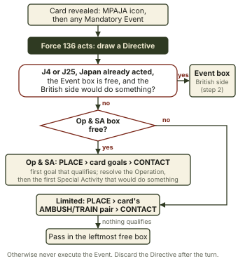

# Force 136 v1.1

**A card-driven British opponent for *The British Way: Japanese Occupation 1942–1945***

Unofficial fan variant · version 1.1 · 21 November 2026

## 1. Overview

You play Japan in the standard standalone Japanese Occupation scenario. Force 136 plays the British. The MPAJA remains the game's independent actor: an MPAJA victory is a loss for both of you.

Force 136 runs on nine Directive cards and the procedures in this booklet. It adds no dice; it rolls only where the game itself calls for a roll (Ambush, J6, J8). It pays every cost and follows every rule a British player follows. It never looks at concealed Intel or at future cards.

**You need:** *The British Way* and the *Enemy of My Enemy* expansion (Japanese Occupation overlay, Event cards, pieces and player aids), the nine Directive cards, this booklet and the reference sheet.

**Printing:** print everything at 100% (actual size). Cut the nine cards on the dashed lines. The page of card backs is optional; all nine backs are the same, so two-sided alignment does not matter. Print the reference sheet two-sided.

## 2. Setup

1. Set up the standard standalone scenario exactly as printed (rulebook, Setup Instructions). Use no Personas, Pre-War Options or campaign links.
2. Choose a level (section 9). At Veteran and Legend, Resistance starts at 4 instead of 2; at Mastermind it starts at 6.
3. Shuffle the nine Directive cards face down. Leave room for a discard pile.

## 3. Terms

- **F136 space:** a space with a Force 136 marker.
- **Red / blue:** MPAJA guerrillas (red cylinders) / non-MPAJA guerrillas (blue cylinders). A **mixed space** has both.
- **Cubes:** Troops plus Police in a space.
- **Majority:** more guerrillas than cubes in a space (it scores +1 Resistance at Propaganda). A space **keeps its majority** if it had one before and still has one after.
- **Good shot:** the space's cubes minus the Supply Caches in and adjacent to it is 3 or less. The Ambush die then succeeds on at least half its faces.
- **Exposed:** a Force 136 marker in a space with Kempeitai and no Jungle Camp. Once the Japanese side of J22 (Jikeidan System) is in play, every Force 136 marker with Kempeitai is exposed.
- **Clear railway:** a railway without Sabotage.
- **Map order:** Kedah, Perak, Kelantan, Trengganu, Pahang, Selangor, Kuala Lumpur, Negri Sembilan, Johore, northern Economic Center, southern Economic Center. It breaks every tie that is left. Thailand is not a space: never a destination, source or target.
- **Railway list** (all eight railways): Perak–Pahang–Selangor, Negri Sembilan–Pahang, Perak–Kelantan, Thailand–Perak, Thailand–Kelantan★, Negri Sembilan–Johore★, Pahang–Johore★, Thailand–Kedah★.
- **"Would":** test the option on the visible board before doing it. A concealed Intel chit counts as a chit; never look at it. Rolls made afterwards (Ambush, J8) don't count: assume they succeed.
- **"Gather would reveal 2 or more"** always means the total over all the spaces Gather selects (6.5).

## 4. Force 136's turn

When each Event card is revealed, its MPAJA icon and then any Mandatory Event are resolved once, before either player acts (rules 2.3 and 5.4). Where they need a British choice, use section 7. Then, whenever Force 136 is to act on that card:

1. **Draw** the top Directive card. When the Directive deck is empty, shuffle the discards to make a new one. Discard the card at the end of the turn.
2. **Events: J4 and J25 only.** If Japan has already acted on this card, the Event box is free and the card is J4 or J25, take the Event box when its British side would do something, play that side, and end the turn:
    - **J4 Chin Peng** — if at least one space has a Force 136 marker and a Jungle Camp, and Resistance is below 20. It adds 1 Resistance for each such space.
    - **J25 John Davis** — if Contact (6.1) or one of Supply, Gather and Raid would do something. Carry out Contact, then the first of Supply, Gather and Raid that would now do something (at Recruit, skip Raid).

    In every other case Force 136 does not execute the Event; Japan may still take it. (Force 136 may Pass in the Event box: step 5.)

3. **If the Op & Special Activity box is free,** choose it. Go down this list and carry out the first goal that qualifies (section 5):
    **PLACE → the goals on the card, top to bottom → CONTACT.**

4. **Otherwise choose Limited Operation.** Go down: **PLACE → the card's Limited choice (AMBUSH or TRAIN), then the other → CONTACT.** A Limited Operation never adds a Special Activity. (A British Limited Train or Ambush may still use every F136 space.)
5. **If nothing qualifies,** Pass in the leftmost free box, even if that is the Event box (passing is not executing the Event; rule 2.4.3). On J6 and J9 the Event box is closed to both players (rule 5.4), so use the leftmost of the other free boxes. Force 136 takes no Contact with the Pass: CONTACT has already failed.

Japan takes at most one box, so Force 136 always has the Op & SA box or the Limited box free. Eligibility then follows the normal cylinder rules.

## 5. Goals

Each goal says when it qualifies and what Force 136 does. Resolve the Operation first, including its rolls; then choose the Special Activity on the board as it now stands. Where a goal lists several Special Activities, take the first that would do something.

**PLACE** — qualifies if a Force 136 marker is Available.
Contact: place it (6.1). *Op & SA:* then Gather if it would reveal 2 or more chits; else Supply; else Raid; else Gather.

**AMBUSH** — qualifies if Ambush would be useful in at least one F136 space (6.3).
Ambush in every F136 space where it is useful. *Op & SA:* then Gather if it would reveal 2 or more chits; else Raid; else Gather.

**INTEL** (Op & SA only). Try these Operations in order, each tested on its own from the current board: Ambush (in every F136 space where it is useful); Sabotage (6.4); Contact (6.1). Skip any that would do nothing. INTEL qualifies with the first one after which Gather would reveal 2 or more chits. Do that Operation, then Gather. If none of them gets Gather to 2, INTEL does not qualify.

**SUPPLY** (Op & SA only; only on Directive 9) — qualifies if Train would place at least one guerrilla and Supply would then convert a Jungle Camp.
Train, then Supply.

**TRAIN** — qualifies if Train would place at least one guerrilla.
Train (6.2). *Op & SA:* then Supply; else Raid.

**CONTACT** — qualifies if Contact would place or move a marker (6.1).
Contact. *Op & SA:* then Supply; else Gather; else Raid.

## 6. Procedures

### 6.1 Contact

**Place.** If a Force 136 marker is Available, place it in a Province without Force 136. Prefer, in order: no Kempeitai; no Supply Cache (only while a Cache is Available); no cubes; most guerrillas; highest Population; map order.

**Move** (only when no marker is Available). Move the first exposed marker in map order that can reach an adjacent Province without Force 136 or Kempeitai. Use the placement preferences to pick the Province. It takes one blue guerrilla (Underground first) along if the destination has no red and another guerrilla stays behind. If no exposed marker can move, Contact would do nothing.

**Camp.** Place a Jungle Camp where the marker arrives, if there is none (Provinces only). If no Camp is Available, take one from the map. Prefer, in order: a Province without Force 136; one with a Supply Cache; the smallest Population; reverse map order.

### 6.2 Train

Train in every F136 space except Economic Centers, in map order: 1 guerrilla, or 2 at a Supply Cache.

- **Colour:** the colour the space already has more of (red on a tie). An empty space takes red if it has a Camp or Cache and red is Available; otherwise blue. Red needs a Camp or Cache: if a space needs red and has neither, skip it.
- **None of that colour Available:** take one from another space without Force 136 that keeps a guerrilla at its Cache and keeps its majority. Choose the source in this order: a space with an Active guerrilla of that colour; the most cubes; map order. Take an Active guerrilla from it if it has one. If no space qualifies, re-place an Active guerrilla of that colour from the Train space itself: it goes back Underground (rule 1.4.1). If there is none, stop training that space.

### 6.3 Ambush

Ambush is useful in a space with an Underground guerrilla: a F136 space for an Ambush Operation, or a Raid destination counting the guerrilla sent there. It is useful if the space has:

1. a good shot and Kempeitai or Troops: roll to move the Kempeitai (or, if there is none, one Troop) to Kuala Lumpur; otherwise
2. Police: remove one Police (no roll).

In Kuala Lumpur only Police removal is useful. Activate red before blue. Work through the spaces in map order. (Game rules: the roll succeeds if the die plus the Caches in and adjacent to the space is higher than the cubes there; each success adds 1 Resistance.)

### 6.4 Sabotage

Work through the F136 spaces in map order. At each, if it still has an Underground guerrilla and an adjacent clear railway, activate one Underground guerrilla (red first) and sabotage the first such railway on the Railway list; otherwise skip it.

### 6.5 Gather

Choose the F136 space whose Gather would reveal the most chits; break ties by map order. A chit counts if it is concealed and an Underground guerrilla is in its own space, which must be the chosen space or adjacent to it. Reveal all of them, activating red before blue. Then choose the next F136 space the same way, up to the printed limit: 2 spaces, or 3 with the British side of J19. With the Japanese side of J19, only the first chosen space may use adjacent spaces; later spaces reveal only their own chit. With the British side of J22, Gather does not activate.

### 6.6 Supply

Choose Provinces that have Force 136 and a Camp but no Cache, up to the printed limit (2, or 3 at Zipper 12 or more) and no more than the Caches Available; then convert their Camps. Supply would do nothing if no Cache is Available or no such Province exists. Prefer, in order: no Kempeitai; most guerrillas; highest Population; map order.

- **British side of J8:** after all the F136 Provinces, one Province without Force 136 may fill a slot that is still open. It does not add a slot.
- **Japanese side of J8:** after choosing, roll for each chosen Province; on 1–2 that Camp is not converted.
- **Japanese side of J27:** remove Opposition from the chosen Province with Opposition that has the lowest Population, then map order.

### 6.7 Raid

Choose up to 2 different destinations (3 at Zipper 20), one at a time. A destination is any space adjacent to a space with a Supply Cache (the source). Send one colour per destination, and never into a space that holds the other colour. After sending, a source must keep at least one guerrilla and keep its majority. Take the first of:

1. **Sabotage:** send 1 Underground guerrilla to a space next to a clear railway. It sabotages the first such railway on the Railway list.
2. **Ambush:** send 1 Underground guerrilla to a space where Ambush would then be useful for it (6.3). It ambushes there.
3. **Majority:** send the fewest guerrillas, 1 or 2 and Underground first, that give a space without a majority more guerrillas than cubes.

A 2-guerrilla Majority comes from one source. The guerrilla sent is activated when it sabotages or ambushes. A Sabotage destination anywhere beats any Ambush, and an Ambush beats any Majority. Ties: destination in map order; the source with most guerrillas, then map order; red before blue.

## 7. Between turns

**MPAJA icons.** *Mobilize Population:* add Opposition to a Province with a Camp, no Terror and no Opposition: highest Population, then map order. *Kill Traitors:* remove a Police from a space with red. Prefer a space with exactly 1 Police; then one with Force 136; then map order. Japan resolves Seize Supplies and Food Shortage.

**Forced British losses** (J6, Clashes). Lose a guerrilla in this order: an Active one before an Underground one; then the minority colour of a mixed space; then blue before red. In J6, lose a Supply Cache only if the space has no guerrilla. Markers are not forces.

**Every Propaganda, including the final one.** At Mobilize, if red runs short, place it in map order.

**Nonfinal Propaganda.**

- *Resources:* for each sabotaged railway, in Railway-list order, set one adjacent Province or Kuala Lumpur without Terror or Opposition to Opposition: highest Population, then map order.
- *Support:* Supply (6.6).
- *Redeploy:* move each exposed Force 136 marker, in map order, to a Camp Province without Force 136 or Kempeitai: most guerrillas, then map order. In a stack, every exposed marker moves, one at a time, each choosing again. A marker moves at most once. Other markers stay.

**Zipper.** If the Zipper falls past a Cache box and no Cache is Available, remove the Cache with fewest guerrillas, then most Troops, then reverse map order.

**Events Japan plays** follow the card text. Japan executes the card, so Japan makes its choices (rule 5.1): which Force 136 marker J20, J25 or J28 removes, and the Camp Province a marker returns to after J25. Where the text gives a choice to Britain, use the matching procedure above. Japan normally plays its own side of the capability cards; if a British side is in play, Force 136 takes every optional benefit it offers, choosing by the matching procedure above, else in map order. In particular:

- *J8, J19, J22:* see Supply (6.6) and Gather (6.5).
- *J12:* when a Construct removes Sabotage from a railway, set one adjacent Province or Kuala Lumpur without Opposition to Opposition: highest Population; then no Terror; then map order.
- *J15:* when Japan Extracts, place one guerrilla in each New Village Province, in map order: the colour the space has more of (red on a tie or if it is empty), if one is Available.
- *J27:* when Force 136 carries out an Ambush or Sabotage Operation, it adds one space without Force 136: the first in map order where that Operation would do something. The extra space never makes a goal qualify: test goals on the F136 spaces only. Raid never adds it.

## 8. Winning

Victory follows the normal rules, checked only at the final Propaganda. Force 136 wins at Resistance 20, or at 18–19 with fewer Jungle Camps than Force 136 markers on the map. At 18–19 otherwise the MPAJA wins and both of you lose. Below 18, Japan wins.

## 9. Levels

| Level | Change | Force 136 win rate* |
|---|---|---|
| Recruit | Force 136 never Raids | 40% |
| Agent | Standard rules | 63% |
| Veteran | Resistance starts at 4 | 72% |
| Legend | Resistance starts at 4, and +1 Resistance after each nonfinal Propaganda | 80% |
| Mastermind | Resistance starts at 6, and +2 Resistance after each nonfinal Propaganda | 90% |

\*Against six computer Japan policies in 6,000 simulated games per level on fresh seeds, never used for tuning. A strong human Japan player should do better than these policies. Start at Agent and move up after two wins in a row. Mastermind is for Japan players who have learned the bot: a computer Japan that previews the bot's reply whenever it acts first on a card beats Agent most of the time (section 11).

At Recruit, skip Raid wherever it appears in a Special Activity list (section 5) and go on to the next choice. The Legend and Mastermind bonus comes after the Resistance phase and the Zipper placement; it does not move the Zipper and never applies at the final Propaganda.

## 10. Worked example: the opening

*From a simulated game; the Japanese choices are one computer policy's.*

**Card 1 (J22), first eligible.** The card's icon is Kill Traitors. Perak and Johore each have red and exactly 1 Police; Perak also has Force 136, so its Police goes. Force 136 draws Directive 8, *Radio from the ridge*. The Op & SA box is free, so it goes down PLACE → INTEL → AMBUSH → TRAIN → CONTACT. PLACE qualifies: one Force 136 marker is Available.

*Where?* The Provinces without Force 136 are Kedah, Kelantan, Trengganu, Pahang, Selangor and Johore. Johore has Kempeitai, so it drops out. None has a Cache, and none of the rest has cubes. Kedah, Kelantan and Pahang each have one guerrilla, and of those Kedah and Kelantan have Population 2. Map order picks Kedah. The marker goes there with a Jungle Camp.

*Special Activity.* The first choice is Gather if it would reveal 2 or more chits. From Perak, Gather reaches the Underground guerrillas in Perak, Kedah, Kelantan and Pahang: 4 chits. The next F136 space is Negri Sembilan, which reaches Negri Sembilan and Johore: 2 more. The guerrillas activate and six chits are revealed. Discard the card.

Japan then takes the Event and plays its Japanese side, so every Force 136 marker with Kempeitai is now exposed.

**Card 2 (J19).** Japan is first eligible and takes Op & SA. Its Sweep moves 2 Troops from Perak into Kedah and activates the Underground red in Perak and Johore; its Eliminate conceals those two chits again. Force 136 must take the Limited Operation. It draws Directive 5, *Recruit and strike* (Limited: TRAIN first). No marker is Available, so PLACE fails and TRAIN qualifies. Train goes in map order. Kedah gains a blue guerrilla (it has blue). Perak has a Cache, so it gains two red guerrillas. Negri Sembilan gains a red one. There is no Special Activity on a Limited Operation.

**Card 3 (J5), first eligible again.** Directive 7, *Count the trains*, lists INTEL first. Only Perak has both a concealed chit and an Underground guerrilla, and Sabotage or Contact would not reach another chit, so INTEL fails. AMBUSH qualifies.

- In Kedah, 2 Troops minus 1 nearby Cache (Perak) is a good shot. The roll succeeds and a Troop goes to Kuala Lumpur (+1 Resistance).
- In Perak, 1 Troop minus 1 Cache is a good shot, so the Kempeitai is the target. That roll also succeeds (+1).

Gather still could not reveal 2 chits, so the Special Activity is Raid. Perak's last Underground red goes to Pahang and sabotages Perak–Pahang–Selangor, the first clear railway on the list. No Underground guerrilla is left at the Perak Cache, so the second Raid can only make a majority: one Active red moves into empty Selangor.

## 11. Design notes

- **Why only J4 and J25?** For v1.1 every Event was retested against the corrected Japan, in paired games (the same seed with and without the Event): 1,536 games per Event and choice, then 6,000 fresh games for each promising one, and 6,000 more for those still ahead.

    - Taken by the first player to act, every Event lowered the win rate, by 1.5 to 26 points in the games where the choice arose, because Japan then takes the Op & SA box. Taking an Event only to keep it from Japan was no better.
    - Taken by the second player, in place of a Limited Operation, only J4 and J25 gained in both fresh runs (J4: +4.3 and +4.1 points where the choice arose; J25: +3.0 and +2.1). J10 and J23 did not repeat their first gains. J26 gained in both runs but not clearly, comes up in about 6% of games, and would need its own targeting rule.
    - The two together add 0.8 to 1.7 points at every level on 6,000 further games per level, and do not hurt against the lookahead Japan.

    Both are cheap to check: J4 counts the spaces with both Force 136 and a Jungle Camp, and J25 is a CONTACT turn.

- **Why PLACE first?** Getting the Available Force 136 marker onto the map is worth more than anything else the bot can do. In early tests, putting it first on Limited turns raised wins from 8% to 34%.
- **Why AMBUSH and INTEL early?** A revealed chit scores at the next Propaganda. A successful Ambush roll sends a unit to Kuala Lumpur for +1 Resistance; rolling at a good shot before removing Police was worth about 5 points. Decks led by AMBUSH, or by INTEL then AMBUSH, won 54–56%. Decks led by INTEL without AMBUSH next won 30–39%, and decks led by SUPPLY or TRAIN won 8–28%.
- **How exploitable is it?** Like any priority bot, Force 136 is predictable. The strongest computer Japan tested, whenever it acts first on a card, previews the bot's reply to each of its 16 best candidate moves, using the bot's real procedures with randomly drawn Directive cards. It strips Cache guards with Reprisal and Assault right after the bot's Gathers and Ambushes have made them Active. Against it Agent wins about 16%, Legend 28% and Mastermind 60% (128 games each). The same opponent also holds a one-step search player, which has no fixed priorities, to 23%, so most of its edge appears to be strong Japanese play rather than knowledge of the bot. Rules meant to guard the Caches made the bot weaker against every opponent, so the levels carry the difference instead.
- **Why re-place Active guerrillas in Train?** Late in a game every guerrilla can be on the map, mostly Active. Taking one from another space comes first because it also builds up the F136 spaces. When no space can give one, re-placing an Active guerrilla in the Train space turns it Underground again for the next Ambush or Gather. Added in v1.0.1, it was worth about 5 points in 6,000 paired games, against every Japan policy.
- **Why does Raid matter?** Raid turns caches into attacks and majorities. Removing it (Recruit) drops the bot by about 22 points.
- **What the cards change:**
    - The Limited first choice: AMBUSH on Directives 1–3, 6 and 7; TRAIN on 4, 5, 8 and 9.
    - Whether INTEL is tried before AMBUSH (6–8). This matters when an Ambush is useful but leaves Gather short and a Sabotage or Contact would not.
    - On Directive 9 only, Train + Supply ahead of INTEL.

    A SUPPLY goal placed next to TRAIN acts exactly like TRAIN, because Train's first Special Activity is Supply, so the other cards don't list it. The mix makes the bot less predictable at almost no cost: a mixed deck scored within one point of the best single order.

## 12. Sources and status

Rules source: GMT Games, *The British Way: Enemy of My Enemy*, Japanese Occupation rulebook (2026) and player aid cards. Card texts were checked against the Event card faces in the Vassal module, version 3.1.1. The physical game and official corrections take precedence. This is an independent fan variant, not a GMT publication. No publisher text, maps or artwork are included.

Status: simulation-tested and not yet tabletop-tested. The simulation report explains the model and its limits.
